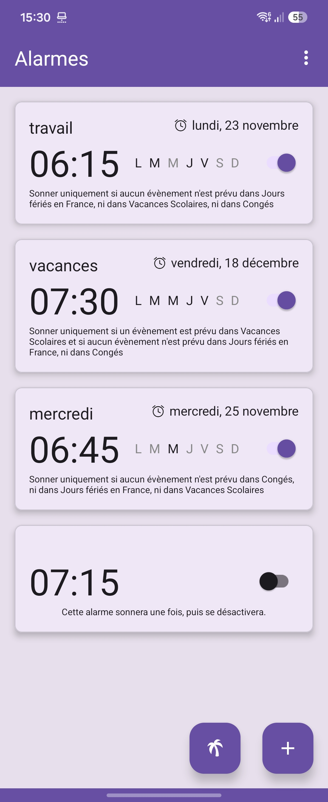
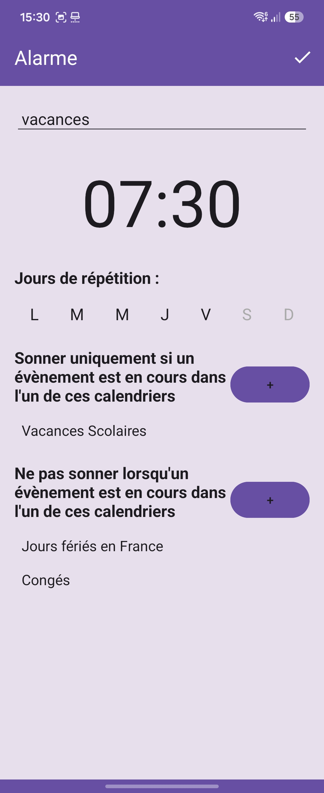
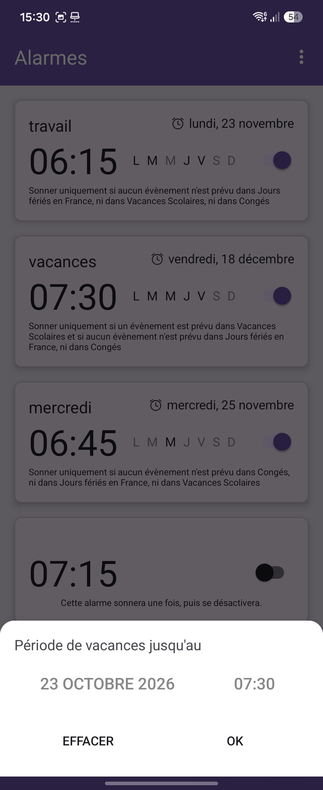

# Alarme

Alarme est une application Android de réveil avec des alarmes récurrentes,
des restrictions liées aux calendriers et des périodes de vacances. Elle propose
notamment une sonnerie progressive, des vibrations et une simulation d’aube.

## Captures d’écran

| Liste des alarmes | Conditions liées aux calendriers |
| --- | --- |
|  |  |

| Sonnerie et simulation d’aube | Période de vacances |
| --- | --- |
|  |  |

<!-- izzypublish:obtainium -->
## Installation et mises à jour

- [Dernière version et APK signé](https://github.com/grrosminet/Alarme/releases/latest)
- [Obtainium](https://github.com/ImranR98/Obtainium)
- [Ajouter dans Obtainium](obtainium://add/https://github.com/grrosminet/Alarme)

1. Installer Obtainium sur Android, puis autoriser l'installation d'applications lorsque demandé.
2. Dans Obtainium, ajouter l'URL `https://github.com/grrosminet/Alarme` (ou ouvrir le lien d'ajout ci-dessus depuis Android).
3. Installer l'APK proposé. Conserver les préversions désactivées.

Obtainium vérifie les GitHub Releases et signale les nouvelles versions ; l'installation
automatique dépend des réglages et des permissions Android. Les mises à jour utilisent
le même identifiant Android et la même clé de signature. Le même APK est destiné
à Obtainium et à IzzyOnDroid ; la disponibilité dans le catalogue IzzyOnDroid dépend
de son inclusion par les mainteneurs.
<!-- /izzypublish:obtainium -->
